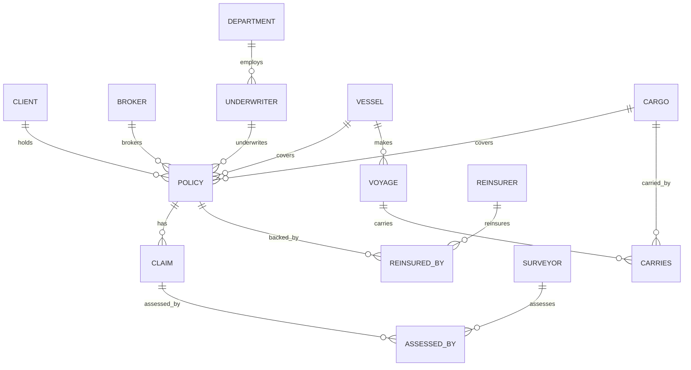
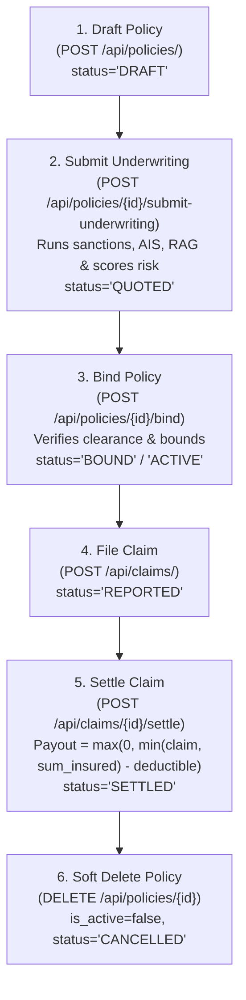

# Marine Insurance REST API (FastAPI + MariaDB)

Backend CRUD API built with **FastAPI**, **SQLAlchemy**, and **MariaDB** (running in Podman). This service provides a complete RESTful interface designed specifically for consumption by frontend applications (React, Vue, Next.js, etc.).

---

## 🚀 Quickstart for Frontend Developers

### 1. Prerequisites
Ensure the MariaDB Podman container is running:
```bash
podman start course-mariadb
```

### 2. Start the Backend Server
Run using `uv` (recommended):
```bash
uv run uvicorn app.main:app --reload --host 0.0.0.0 --port 8000
```
Or with standard virtualenv:
```bash
source .venv/bin/activate
uvicorn app.main:app --reload --host 0.0.0.0 --port 8000
```

The API will be available at:
- **Base API URL**: `http://localhost:8000/api`
- **Interactive Swagger UI**: [http://localhost:8000/docs](http://localhost:8000/docs)
- **ReDoc Documentation**: [http://localhost:8000/redoc](http://localhost:8000/redoc)
- **Health Check**: [http://localhost:8000/api/health](http://localhost:8000/api/health)

### 3. CORS Support
CORS is preconfigured to accept requests from any origin (`*`) with credentials, methods (`GET`, `POST`, `PUT`, `DELETE`), and headers allowed. Frontend servers on `http://localhost:3000`, `http://localhost:5173`, etc. can call this API without CORS errors.

---

## 🗂️ Data Models & Entity Relationships



---

## 📡 API Endpoints Reference

All single-column primary keys are automatically generated using `AUTO_INCREMENT`. You do not need to provide IDs when creating entities (`POST`).

### 1. Independent Entities

| Resource | Base Path | Methods | Fields |
|---|---|---|---|
| **Clients** | `/api/clients/` | `GET`, `POST`, `PUT`, `DELETE` | `client_id`, `name`, `address`, `is_active` |
| **Brokers** | `/api/brokers/` | `GET`, `POST`, `PUT`, `DELETE` | `broker_id`, `agency_name`, `licence_no` (Unique), `is_active` |
| **Surveyors** | `/api/surveyors/` | `GET`, `POST`, `PUT`, `DELETE` | `surveyor_id`, `name`, `qualification` |
| **Reinsurers** | `/api/reinsurers/` | `GET`, `POST`, `PUT`, `DELETE` | `reinsurer_id`, `name` |
| **Cargos** | `/api/cargos/` | `GET`, `POST`, `PUT`, `DELETE` | `cargo_id`, `description`, `value` |
| **Vessels** | `/api/vessels/` | `GET`, `POST`, `PUT`, `DELETE` | `vessel_id`, `name`, `imo_number` (Unique), `tonnage`, `flag`, `is_active` |
| **Departments** | `/api/departments/` | `GET`, `POST`, `PUT`, `DELETE` | `dept_id`, `name`, `location` |

### 2. Dependent Entities & Workflow Endpoints

| Resource | Base Path | Methods | Key Fields & Workflow Actions |
|---|---|---|---|
| **Underwriters** | `/api/underwriters/` | `GET`, `POST`, `PUT`, `DELETE` | `emp_id`, `name`, `designation`, `dept_id` |
| **Voyages** | `/api/voyages/` | `GET`, `POST`, `PUT`, `DELETE` | `voyage_id`, `origin_port`, `dest_port`, `depart_date`, `vessel_id` |
| **Policies** | `/api/policies/` | `GET`, `POST`, `PUT`, `DELETE` | `policy_no`, `policy_type` (`'HULL'`, `'CARGO'`, `'PI'`), `status` (`'DRAFT'`, `'QUOTED'`, `'BOUND'`, `'ACTIVE'`, `'CANCELLED'`), `deductible` (default 10000.00), `underwriting_decision`, `risk_score`, `warranties`, `awrp_surcharge`, `is_active`, `sum_insured`, `premium`, Foreign Keys |
| **Policy Underwriting** | `/api/policies/{policy_no}/submit-underwriting` | `POST` | Executes underwriting engine, writes score/decision/warranties, transitions status to `'QUOTED'` |
| **Policy Binding** | `/api/policies/{policy_no}/bind` | `POST` | Binds policy: transitions status from `'QUOTED'`/`'DRAFT'` to `'BOUND'` or `'ACTIVE'` |
| **Claims** | `/api/claims/` | `GET`, `POST`, `PUT`, `DELETE` | `claim_id`, `loss_date`, `claim_amount`, `status` (`'REPORTED'`, `'UNDER_SURVEY'`, `'APPROVED'`, `'SETTLED'`, `'REJECTED'`), `reserve_amount`, `deductible_applied`, `settled_amount`, `is_active`, `policy_no` |
| **Claim Settlement** | `/api/claims/{claim_id}/settle` | `POST` | Calculates payout: `max(0, min(claim_amount, sum_insured) - deductible)`, writes `settled_amount` & `deductible_applied`, updates status to `'SETTLED'` |

### 3. Junction Entities (Many-to-Many with Composite Keys)

| Resource | Base Path | Methods | Composite Key |
|---|---|---|---|
| **Reinsured By** | `/api/reinsured-by/` | `GET`, `POST`, `PUT`, `DELETE` | `/{policy_no}/{reinsurer_id}` (`share_percent`) |
| **Assessed By** | `/api/assessed-by/` | `GET`, `POST`, `DELETE` | `/{claim_id}/{surveyor_id}` |
| **Carries** | `/api/carries/` | `GET`, `POST`, `DELETE` | `/{voyage_id}/{cargo_id}` |

---

## 🌊 Marine Insurance Lifecycle Workflow Guide

The complete marine insurance operational lifecycle follows a deterministic 6-step lifecycle:



### Step 1: Draft Policy (`POST /api/policies/`)
Creates an initial policy record with status `'DRAFT'`, default deductible `10000.00`, and `is_active=true`.
```json
{
  "policy_type": "HULL",
  "issue_date": "2026-06-01",
  "expiry_date": "2027-05-31",
  "premium": 20000.00,
  "sum_insured": 500000.00,
  "deductible": 15000.00,
  "client_id": 1,
  "vessel_id": 1
}
```

### Step 2: Submit for Underwriting (`POST /api/policies/{policy_no}/submit-underwriting`)
Synthesizes OFAC SDN sanctions screening, AIS navigational corridor hazards, loss ratios, and Institute Clause warranties. Writes `underwriting_decision`, `risk_score`, `warranties`, and `awrp_surcharge` to the database and transitions status to `'QUOTED'`.

### Step 3: Bind Policy (`POST /api/policies/{policy_no}/bind`)
Binds the quoted policy, transitioning status to `'BOUND'` or `'ACTIVE'`. Automatically rejects binding if the underwriting engine issued a `'DECLINE'` decision.

### Step 4: File a Claim (`POST /api/claims/`)
Policyholder reports a loss against the active policy with initial status `'REPORTED'`:
```json
{
  "loss_date": "2026-08-15",
  "claim_amount": 65000.00,
  "policy_no": 1
}
```

### Step 5: Settle Claim with Deductible (`POST /api/claims/{claim_id}/settle`)
Executes maritime claim adjustment formula:
$$\text{payout} = \max\left(0, \min(\text{claim\_amount}, \text{sum\_insured}) - \text{policy.deductible}\right)$$
Sets `settled_amount` to payout, records `deductible_applied`, and updates status to `'SETTLED'`.

### Step 6: Soft Delete (`DELETE /api/policies/{policy_no}`)
Soft deletes the policy, setting `is_active=false` and `status='CANCELLED'`. Preserves historical integrity while preventing further binding or active operations.

---

## 📄 Standard Paginated Response Envelope & Search Filters

All list queries on `/api/policies/` and `/api/claims/` return standard paginated envelopes:

```json
{
  "items": [...],
  "total": 42,
  "page": 1,
  "limit": 20,
  "total_pages": 3
}
```

### Query Parameters
- `?page=1`: 1-indexed page number (default: `1`)
- `?limit=20`: Maximum items per page (default: `50`, max: `500`)
- `?skip=0`: Optional offset override
- `?search=...`: Case-insensitive search across IDs, names, statuses, and types
- `?status=...`: Exact filter by status (e.g., `ACTIVE`, `QUOTED`, `REPORTED`, `SETTLED`)
- `?is_active=true|false`: Filter by active / soft-deleted state

---

---

## 💡 Example Payloads for Frontend Forms

### Create a Client (`POST /api/clients/`)
```json
{
  "name": "Oceanic Logistics Corp",
  "address": "100 Harbour View, Singapore"
}
```

### Create a Policy (`POST /api/policies/`)
```json
{
  "policy_type": "HULL",
  "issue_date": "2026-01-01",
  "expiry_date": "2026-12-31",
  "premium": 45000.00,
  "sum_insured": 50000000.00,
  "vessel_value_covered": 50000000.00,
  "client_id": 1,
  "broker_id": 1,
  "emp_id": 1,
  "vessel_id": 1
}
```

### File a Claim (`POST /api/claims/`)
```json
{
  "loss_date": "2026-05-14",
  "claim_amount": 185000.00,
  "policy_no": 1
}
```

### Link a Reinsurer to a Policy (`POST /api/reinsured-by/`)
```json
{
  "policy_no": 1,
  "reinsurer_id": 1,
  "share_percent": 40.00
}
```

---

---

## 🤖 Automated Underwriting & Evaluation Engine

The platform includes an automated marine risk assessment and evaluation engine layered on top of MariaDB:

### Endpoints
- **`POST /api/underwriting/assess`**: Submits a policy application and returns:
  - `decision`: (`APPROVE`, `APPROVE_WITH_CONDITIONS`, `REFER_TO_SENIOR`, `DECLINE`)
  - `risk_score`: 1 to 100
  - `sanctions_cleared`: `true`/`false`
  - `recommended_premium`: Computed based on risk surcharges and AWRP
  - `warranties_required`: E.g. BMP West Africa, IACS survey warranty, 48-hour JWC transit notice
  - `retrieved_guidelines`: Clauses pulled via BM25 RAG from Institute Clauses & JWC manuals.
- **`GET /api/underwriting/sanctions-check?imo_number=...`**: Real-time screening against OFAC SDN maritime sanctioned vessels and entities.
- **`POST /api/underwriting/evaluate-engine`**: Executes the deterministic rubric benchmark suite (evaluating sanctions zero-tolerance and risk score boundaries).

### Example Underwriting Request
```bash
curl -X POST http://localhost:8000/api/underwriting/assess \
  -H "Content-Type: application/json" \
  -d '{
    "policy_type": "HULL",
    "sum_insured": 25000000,
    "imo_number": "IMO9123456",
    "vessel_age": 18,
    "origin_port": "Rotterdam",
    "dest_port": "Singapore"
  }'
```

---

## 🛠️ Database Setup and Maintenance Scripts

If you ever need to reset or re-seed the MariaDB database:

1. **Re-initialize Schema**:
   ```bash
   uv run python scripts/init_db.py
   ```
2. **Apply v2 Database Migrations**:
   ```bash
   uv run python scripts/migrate_v2.py
   ```
3. **Re-seed Sample Data**:
   ```bash
   uv run python scripts/seed_data.py
   ```
4. **Run Automated Test Suite**:
   ```bash
   uv run pytest tests/ -v
   ```

