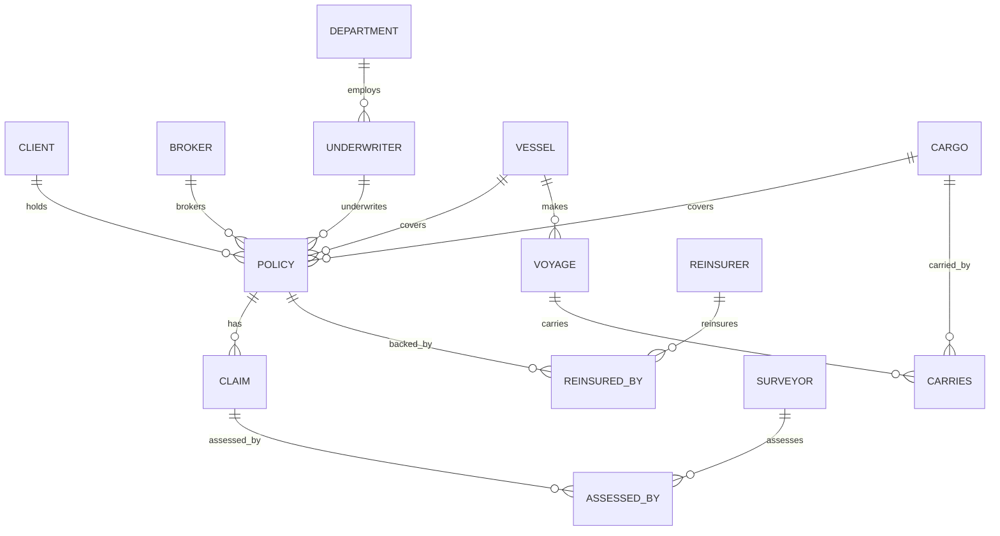

# Marine Insurance REST API (FastAPI + MariaDB)

Backend CRUD API built with **FastAPI**, **SQLAlchemy**, and **MariaDB** (running in Podman). This service provides a complete RESTful interface designed specifically for consumption by frontend applications.

> 📱 **Swift / iOS Developers**: Check out the dedicated [Swift / SwiftUI Frontend Handoff Guide](FRONTEND_HANDOFF_SWIFT.md) for ready-to-copy `Codable` structs, `async/await` API Client, and complete SwiftUI views.

---

## 🚀 Quickstart for Frontend Developers

### 1. Prerequisites
Ensure the MariaDB Podman container is running:
```bash
podman start course-mariadb
```

First time only, create the container and the tables:
```bash
podman machine init && podman machine start
podman run -d --name course-mariadb -p 3306:3306 \
  -e MARIADB_ROOT_PASSWORD=mysecretpassword docker.io/library/mariadb:11
uv run python scripts/init_db.py
uv run python scripts/seed_data.py
```
If port 3306 is already taken (e.g. by a local MySQL), use `-p 3307:3306` and set `DB_PORT=3307` in `.env`.

### 2. Start the Backend Server
Run using `uv` (recommended):
```bash
uv run uvicorn app.main:app --reload --host 0.0.0.0 --port 8000
```
Or with standard virtualenv:
```bash
source .venv/bin/activate
uvicorn app.main:app --reload --host 0.0.0.0 --port 8000
```

The API will be available at:
- **Base API URL**: `http://localhost:8000/api`
- **Interactive Swagger UI**: [http://localhost:8000/docs](http://localhost:8000/docs)
- **ReDoc Documentation**: [http://localhost:8000/redoc](http://localhost:8000/redoc)
- **Health Check**: [http://localhost:8000/api/health](http://localhost:8000/api/health)

### 3. CORS Support
CORS is preconfigured to accept requests from any origin (`*`) with credentials, methods (`GET`, `POST`, `PUT`, `DELETE`), and headers allowed. Frontend servers on `http://localhost:3000`, `http://localhost:5173`, etc. can call this API without CORS errors.

---

## 🗂️ Data Models & Entity Relationships



---

## 📡 API Endpoints Reference

All single-column primary keys are automatically generated using `AUTO_INCREMENT`. You do not need to provide IDs when creating entities (`POST`).

### 1. Independent Entities

| Resource | Base Path | Methods | Fields |
|---|---|---|---|
| **Clients** | `/api/clients/` | `GET`, `POST`, `PUT`, `DELETE` | `client_id`, `name`, `address` |
| **Brokers** | `/api/brokers/` | `GET`, `POST`, `PUT`, `DELETE` | `broker_id`, `agency_name`, `licence_no` (Unique) |
| **Surveyors** | `/api/surveyors/` | `GET`, `POST`, `PUT`, `DELETE` | `surveyor_id`, `name`, `qualification` |
| **Reinsurers** | `/api/reinsurers/` | `GET`, `POST`, `PUT`, `DELETE` | `reinsurer_id`, `name` |
| **Cargos** | `/api/cargos/` | `GET`, `POST`, `PUT`, `DELETE` | `cargo_id`, `description`, `value` |
| **Vessels** | `/api/vessels/` | `GET`, `POST`, `PUT`, `DELETE` | `vessel_id`, `name`, `imo_number` (Unique), `tonnage`, `flag` |
| **Departments** | `/api/departments/` | `GET`, `POST`, `PUT`, `DELETE` | `dept_id`, `name`, `location` |

### 2. Dependent Entities

| Resource | Base Path | Methods | Key Foreign Keys & Details |
|---|---|---|---|
| **Underwriters** | `/api/underwriters/` | `GET`, `POST`, `PUT`, `DELETE` | `emp_id`, `name`, `designation`, `dept_id` |
| **Voyages** | `/api/voyages/` | `GET`, `POST`, `PUT`, `DELETE` | `voyage_id`, `origin_port`, `dest_port`, `depart_date`, `vessel_id` |
| **Policies** | `/api/policies/` | `GET`, `POST`, `PUT`, `DELETE` | `policy_no`, `policy_type` (`'HULL'`, `'CARGO'`, `'PI'`), `issue_date`, `expiry_date`, `premium`, `sum_insured`, `client_id`, `broker_id`, `emp_id`, `vessel_id`, `cargo_id` |
| **Claims** | `/api/claims/` | `GET`, `POST`, `PUT`, `DELETE` | `claim_id`, `loss_date`, `claim_amount`, `policy_no` |

### 3. Junction Entities (Many-to-Many with Composite Keys)

| Resource | Base Path | Methods | Composite Key |
|---|---|---|---|
| **Reinsured By** | `/api/reinsured-by/` | `GET`, `POST`, `PUT`, `DELETE` | `/{policy_no}/{reinsurer_id}` (`share_percent`) |
| **Assessed By** | `/api/assessed-by/` | `GET`, `POST`, `DELETE` | `/{claim_id}/{surveyor_id}` |
| **Carries** | `/api/carries/` | `GET`, `POST`, `DELETE` | `/{voyage_id}/{cargo_id}` |

---

## 💡 Example Payloads for Frontend Forms

### Create a Client (`POST /api/clients/`)
```json
{
  "name": "Oceanic Logistics Corp",
  "address": "100 Harbour View, Singapore"
}
```

### Create a Policy (`POST /api/policies/`)
```json
{
  "policy_type": "HULL",
  "issue_date": "2026-01-01",
  "expiry_date": "2026-12-31",
  "premium": 45000.00,
  "sum_insured": 50000000.00,
  "vessel_value_covered": 50000000.00,
  "client_id": 1,
  "broker_id": 1,
  "emp_id": 1,
  "vessel_id": 1
}
```

### File a Claim (`POST /api/claims/`)
```json
{
  "loss_date": "2026-05-14",
  "claim_amount": 185000.00,
  "policy_no": 1
}
```

### Link a Reinsurer to a Policy (`POST /api/reinsured-by/`)
```json
{
  "policy_no": 1,
  "reinsurer_id": 1,
  "share_percent": 40.00
}
```

---

---

## ⚡ DBMS Concurrency Control Demonstration

To satisfy the DBMS coursework requirement for demonstrating **concurrent transaction execution and ACID properties**, this system includes a live concurrency demonstration modeling **concurrent claims processing against an aggregate policy limit**.

### Scenario:
A marine policy has an aggregate coverage limit of **$100,000.00**. Two independent adjusters attempt to settle **$60,000.00** claims simultaneously (total = $120,000.00).

```mermaid
sequenceDiagram
    autonumber
    actor T1 as Thread 1 (Adjuster A)
    actor T2 as Thread 2 (Adjuster B)
    participant DB as MariaDB (Engine)

    Note over T1,T2: PART 2: ACID Locking (SELECT ... FOR UPDATE)
    T1->>DB: BEGIN TX; SELECT ... FOR UPDATE (Policy #1)
    activate DB
    Note over DB: Exclusive X-Lock Acquired by T1
    T2->>DB: BEGIN TX; SELECT ... FOR UPDATE (Policy #1)
    Note over T2,DB: Thread 2 BLOCKED waiting for Lock
    T1->>DB: Read remaining: $100k; Pay $60k; COMMIT
    deactivate DB
    Note over DB: T1 releases lock. Remaining = $40k
    activate DB
    Note over T2,DB: Thread 2 UNBLOCKS; Reads remaining: $40k
    T2->>DB: $60k > $40k remaining -> ROLLBACK
    deactivate DB
    Note over DB: Consistency Maintained! ($60k paid <= $100k limit)
```

### 1. Run Live Interactive Terminal Demo:
```bash
uv run python scripts/demo_concurrency.py
```
This runs both scenarios in real time and prints the thread-level lock acquisitions, timeouts, and transaction commits/rollbacks.

### 2. Live API Endpoints:
- **`POST /api/concurrency/demo-race-condition`**: Demonstrates the anomaly when rows are not locked (over-payment breach of $20,000.00).
- **`POST /api/concurrency/demo-safe-transaction`**: Demonstrates MariaDB row-level locking (`SELECT ... FOR UPDATE`), serializing concurrent transactions and safely rolling back the exceeding transaction.

---

## 🔄 Policy Lifecycle & Claims Settlement

The API models practical marine insurance workflow states:
- **Policy Lifecycle**: `DRAFT` ➔ `QUOTED` ➔ `BOUND`
  - `POST /api/policies/{policy_no}/quote`
  - `POST /api/policies/{policy_no}/bind`
- **Claims Settlement**:
  - `POST /api/claims/{claim_id}/settle`: Automatically computes net payout deducting the policy deductible:
    $$\text{Payout} = \min(\max(0, \text{Claim Amount} - \text{Deductible}), \max(0, \text{Sum Insured} - \text{Prior Payouts}))$$

---

## 🛠️ Database Setup and Maintenance Scripts

If you ever need to reset or re-seed the MariaDB database:

1. **Re-initialize Schema**:
   ```bash
   uv run python scripts/init_db.py
   ```
2. **Re-seed Sample Data**:
   ```bash
   uv run python scripts/seed_data.py
   ```
3. **Run Concurrency Demo**:
   ```bash
   uv run python scripts/demo_concurrency.py
   ```
4. **Run Automated Test Suite**:
   ```bash
   uv run pytest tests/ -v
   ```


## Underwriting demo

Fathom can assess a draft policy using local rules, claims history, and keyword
retrieval over the bundled guidelines. The sanctions entries are synthetic
coursework fixtures. Route checks use port names and fixed geographic areas,
not a live AIS feed. These inputs do not establish real sanctions clearance.

For an existing database, run the additive migration before starting this version:

```bash
uv sync --extra dev
uv run python scripts/migrate_v2.py
```

New databases created with `scripts/init_db.py` already contain the new columns.
The migration can be run again without resetting records.

In the iOS app, open a draft or quoted policy, scroll to **Underwriting**, and tap
**Assess risk**. Enter the vessel age and select a voyage belonging to that vessel.
The database does not store vessel age, so the form starts at 10 years and shows
the age used in the saved report. Choosing no voyage skips route assessment.

The assessment saves a risk score, decision, conditions, surcharge, and supporting
guideline excerpts. It fills the premium only when the policy has no premium.
Decisions are `APPROVE`, `APPROVE_WITH_CONDITIONS`, `REFER_TO_SENIOR`, or `DECLINE`.
Declined and referred policies cannot be bound. Senior review remains a manual
process outside this demo; it has no approval override endpoint.

The existing Quote and Bind workflow still works without an assessment. Binding
always screens the linked client and vessel against the fixtures, including when
coverage is created directly as BOUND or ACTIVE. Assessed policies also recheck
risk at binding time. Changing assessment inputs on a draft clears its old report.
Bound coverage rejects changes to those inputs.

| Endpoint | Purpose |
|---|---|
| `POST /api/underwriting/assess` | Preview risk without saving a policy |
| `GET /api/underwriting/sanctions-check` | Check the local sanctions fixtures |
| `POST /api/underwriting/evaluate-engine` | Run four synthetic benchmark cases |
| `POST /api/policies/{policy_no}/submit-underwriting` | Assess and save a policy report |

Example submission body:

```json
{"vessel_age": 12, "voyage_id": 1}
```

The preview endpoint also requires `policy_type` and positive `sum_insured`.
Supplied entity IDs must exist; a selected voyage must belong to the selected
vessel. Database identities take precedence over supplied names.

Policy and claim list endpoints keep returning arrays with `X-Total-Count` for
existing clients. Passing `page=1&limit=50` opts into an object containing `items`,
`total`, `page`, `limit`, and `total_pages`. Normal DELETE calls still permanently
remove records and apply database cascades. Pass `permanent=false` to archive a
policy or claim instead, and use `is_active` to filter lists. Archiving a policy
cancels it and blocks further settlements without deleting its claims.

Run backend tests against a separate seeded database:

```bash
DB_NAME=marine_insurance_underwriting_test uv run python scripts/init_db.py
DB_NAME=marine_insurance_underwriting_test uv run python scripts/seed_data.py
DB_NAME=marine_insurance_underwriting_test uv run pytest tests/ -q
```

Generate the iOS project with `xcodegen generate --spec ios/project.yml`.
`FathomTests` covers report decoding and binding decisions.
`UnderwritingUITests` needs the API running at `http://127.0.0.1:8000` and exercises
assessment, voyage selection, saved results, binding, and a declined policy.

See the [short demo](docs/underwriting/demo.mp4) and screenshots of an
[assessment](docs/underwriting/assessment.png) and a
[declined policy](docs/underwriting/declined.png).
