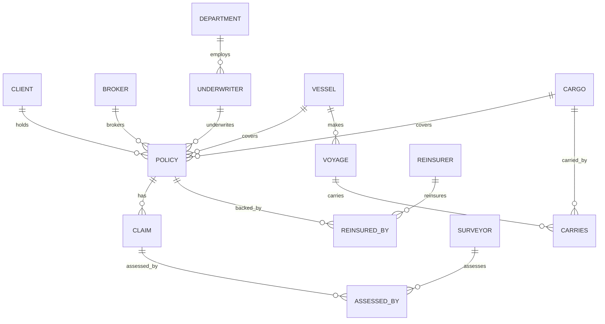

# Marine Insurance REST API (FastAPI + MariaDB)

Backend CRUD API built with **FastAPI**, **SQLAlchemy**, and **MariaDB** (running in Podman). This service provides a complete RESTful interface designed specifically for consumption by frontend applications (React, Vue, Next.js, etc.).

---

## 🚀 Quickstart for Frontend Developers

### 1. Prerequisites
Ensure the MariaDB Podman container is running:
```bash
podman start course-mariadb
```

### 2. Start the Backend Server
Run using `uv` (recommended):
```bash
uv run uvicorn app.main:app --reload --host 0.0.0.0 --port 8000
```
Or with standard virtualenv:
```bash
source .venv/bin/activate
uvicorn app.main:app --reload --host 0.0.0.0 --port 8000
```

The API will be available at:
- **Base API URL**: `http://localhost:8000/api`
- **Interactive Swagger UI**: [http://localhost:8000/docs](http://localhost:8000/docs)
- **ReDoc Documentation**: [http://localhost:8000/redoc](http://localhost:8000/redoc)
- **Health Check**: [http://localhost:8000/api/health](http://localhost:8000/api/health)

### 3. CORS Support
CORS is preconfigured to accept requests from any origin (`*`) with credentials, methods (`GET`, `POST`, `PUT`, `DELETE`), and headers allowed. Frontend servers on `http://localhost:3000`, `http://localhost:5173`, etc. can call this API without CORS errors.

---

## 🗂️ Data Models & Entity Relationships



---

## 📡 API Endpoints Reference

All single-column primary keys are automatically generated using `AUTO_INCREMENT`. You do not need to provide IDs when creating entities (`POST`).

### 1. Independent Entities

| Resource | Base Path | Methods | Fields |
|---|---|---|---|
| **Clients** | `/api/clients/` | `GET`, `POST`, `PUT`, `DELETE` | `client_id`, `name`, `address` |
| **Brokers** | `/api/brokers/` | `GET`, `POST`, `PUT`, `DELETE` | `broker_id`, `agency_name`, `licence_no` (Unique) |
| **Surveyors** | `/api/surveyors/` | `GET`, `POST`, `PUT`, `DELETE` | `surveyor_id`, `name`, `qualification` |
| **Reinsurers** | `/api/reinsurers/` | `GET`, `POST`, `PUT`, `DELETE` | `reinsurer_id`, `name` |
| **Cargos** | `/api/cargos/` | `GET`, `POST`, `PUT`, `DELETE` | `cargo_id`, `description`, `value` |
| **Vessels** | `/api/vessels/` | `GET`, `POST`, `PUT`, `DELETE` | `vessel_id`, `name`, `imo_number` (Unique), `tonnage`, `flag` |
| **Departments** | `/api/departments/` | `GET`, `POST`, `PUT`, `DELETE` | `dept_id`, `name`, `location` |

### 2. Dependent Entities

| Resource | Base Path | Methods | Key Foreign Keys & Details |
|---|---|---|---|
| **Underwriters** | `/api/underwriters/` | `GET`, `POST`, `PUT`, `DELETE` | `emp_id`, `name`, `designation`, `dept_id` |
| **Voyages** | `/api/voyages/` | `GET`, `POST`, `PUT`, `DELETE` | `voyage_id`, `origin_port`, `dest_port`, `depart_date`, `vessel_id` |
| **Policies** | `/api/policies/` | `GET`, `POST`, `PUT`, `DELETE` | `policy_no`, `policy_type` (`'HULL'`, `'CARGO'`, `'PI'`), `issue_date`, `expiry_date`, `premium`, `sum_insured`, `client_id`, `broker_id`, `emp_id`, `vessel_id`, `cargo_id` |
| **Claims** | `/api/claims/` | `GET`, `POST`, `PUT`, `DELETE` | `claim_id`, `loss_date`, `claim_amount`, `policy_no` |

### 3. Junction Entities (Many-to-Many with Composite Keys)

| Resource | Base Path | Methods | Composite Key |
|---|---|---|---|
| **Reinsured By** | `/api/reinsured-by/` | `GET`, `POST`, `PUT`, `DELETE` | `/{policy_no}/{reinsurer_id}` (`share_percent`) |
| **Assessed By** | `/api/assessed-by/` | `GET`, `POST`, `DELETE` | `/{claim_id}/{surveyor_id}` |
| **Carries** | `/api/carries/` | `GET`, `POST`, `DELETE` | `/{voyage_id}/{cargo_id}` |

---

## 💡 Example Payloads for Frontend Forms

### Create a Client (`POST /api/clients/`)
```json
{
  "name": "Oceanic Logistics Corp",
  "address": "100 Harbour View, Singapore"
}
```

### Create a Policy (`POST /api/policies/`)
```json
{
  "policy_type": "HULL",
  "issue_date": "2026-01-01",
  "expiry_date": "2026-12-31",
  "premium": 45000.00,
  "sum_insured": 50000000.00,
  "vessel_value_covered": 50000000.00,
  "client_id": 1,
  "broker_id": 1,
  "emp_id": 1,
  "vessel_id": 1
}
```

### File a Claim (`POST /api/claims/`)
```json
{
  "loss_date": "2026-05-14",
  "claim_amount": 185000.00,
  "policy_no": 1
}
```

### Link a Reinsurer to a Policy (`POST /api/reinsured-by/`)
```json
{
  "policy_no": 1,
  "reinsurer_id": 1,
  "share_percent": 40.00
}
```

---

## 🛠️ Database Setup and Maintenance Scripts

If you ever need to reset or re-seed the MariaDB database:

1. **Re-initialize Schema**:
   ```bash
   uv run python scripts/init_db.py
   ```
2. **Re-seed Sample Data**:
   ```bash
   uv run python scripts/seed_data.py
   ```
3. **Run Automated Test Suite**:
   ```bash
   uv run pytest tests/ -v
   ```
